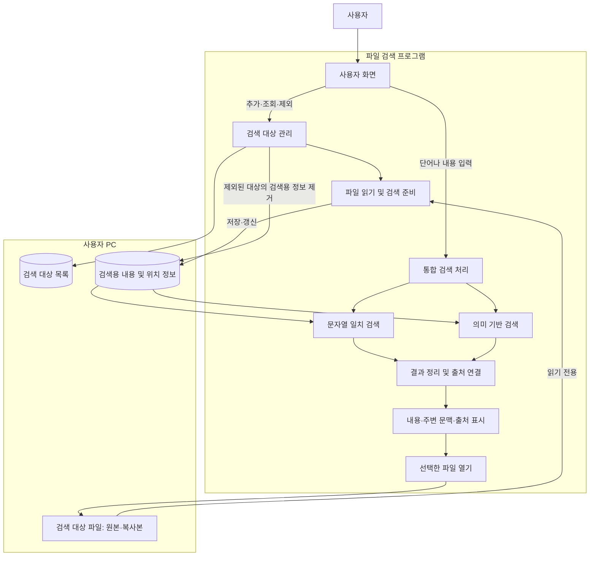
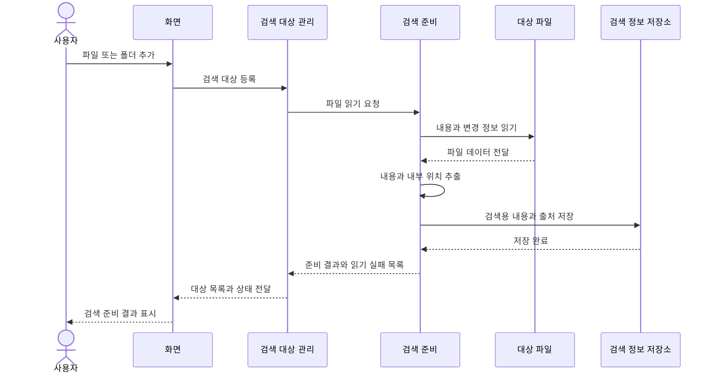
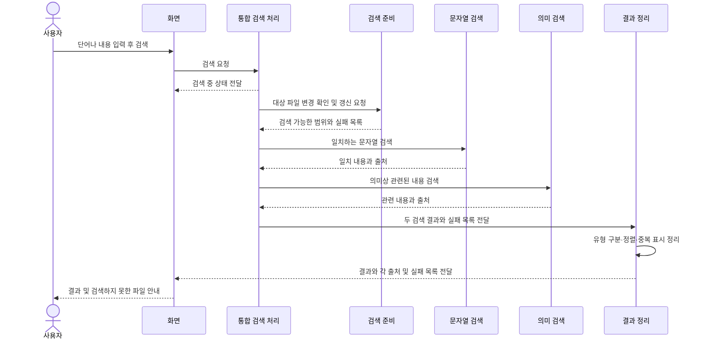
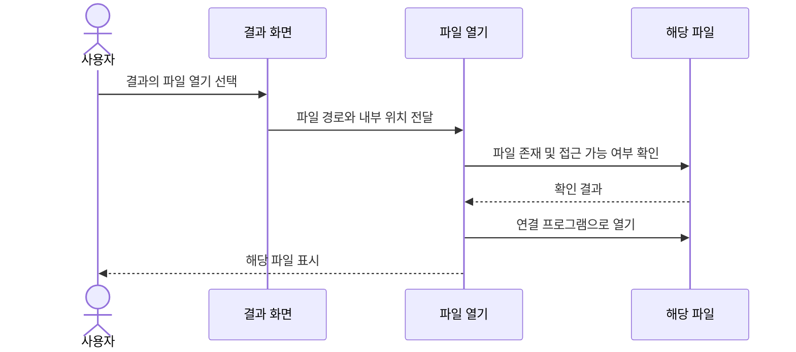
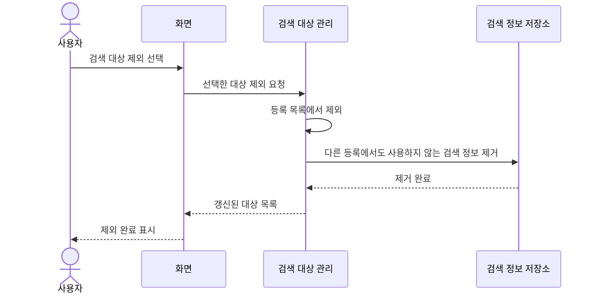

# MyProject
https://pofo.kr/ 활용가능

[파일검색_요구사항_설계.md](https://github.com/user-attachments/files/33373369/_._.md)

# 파일 검색 프로그램 요구사항 및 설계

## 1. 문서 범위

사용자가 단어나 내용을 입력하면 검색 대상 파일에서 필요한 정보를 찾아, 검색된 내용과 출처를 명확하게 보여주는 프로그램이다. 원본과 복사본 모두 검색 대상이 될 수 있다.

이 문서는 합의된 문제 정의와 요구사항, 이를 구현하기 위한 아키텍처 및 시퀀스 다이어그램을 정리한다. 개인 PC 실행, 검색 정보 사전 저장 등은 확정된 요구사항과 구분하여 **설계 제안**으로 표시한다. 다이어그램은 해당 제안을 채택했을 때의 흐름이다.

## 2. 문제 정의

| 항목 | 정의 |
|---|---|
| 대상 사용자 | 필요한 정보가 어느 파일에 있는지 몰라 찾기 어려운 개인 및 업무 사용자 |
| 문제 | 여러 파일을 하나씩 열어 확인해야 하며, 정확한 표현을 기억하지 못하면 검색이 어렵다. |
| 목적 | 기억나는 단어나 내용으로 정보를 빠르게 찾고, 검색된 내용과 출처를 함께 확인하도록 돕는다. |
| 검색 대상 | 사용자가 등록한 파일과 폴더. 원본과 복사본 모두 포함한다. |
| 핵심 가치 | 사용 편의성, 검색 정확성, 결과와 출처의 명확성 |
| 성공 기준 | 필요한 정보를 빠르게 찾고, 표시된 파일과 위치에서 해당 내용을 확인할 수 있다. |

**출처**는 최초 작성된 원본이 아니라, 해당 내용이 실제로 발견된 파일과 파일 내부 위치를 의미한다.

## 3. 사용자 흐름과 검색 방식

검색 대상 추가 → 목록 확인·관리 → 검색어 입력 → 검색 상태 확인 → 결과와 출처 확인 → 해당 파일 열기

검색 대상 제외는 필요할 때 수행한다. 목록에서 제외해도 실제 파일은 삭제하지 않는다.

| 검색 방식 | 동작 | `환불 조건` 검색 예시 |
|---|---|---|
| 문자열 일치 검색 | 입력한 글자가 실제로 포함된 부분을 찾는다. | “환불 조건은 다음과 같습니다.” |
| 의미 기반 검색 | 표현이 달라도 의미상 관련된 내용을 찾는다. | “구매 후 7일 이내 반품할 수 있습니다.” |

사용자는 검색창 하나에 입력한다. 프로그램 내부에서 두 방식으로 검색하며 결과는 ‘정확히 일치’와 ‘관련 내용’으로 구분한다. 두 방식 모두 실제 파일에서 찾은 내용과 출처를 제공한다. 의미상 관련된 결과가 사용자가 원하는 정보인지는 주변 문맥을 보고 확인할 수 있도록 한다.

## 4. 기능 요구사항

| ID | 기능 | 상세 요구사항 |
|---|---|---|
| FR-01 | 검색 대상 추가 | 파일이나 폴더를 검색 대상 목록에 추가할 수 있어야 한다. 원본과 복사본 모두 등록할 수 있어야 한다. |
| FR-02 | 검색 대상 조회 | 등록된 검색 대상 목록을 확인할 수 있어야 한다. |
| FR-03 | 검색 대상 제외 | 등록된 대상을 목록에서 제외할 수 있어야 한다. 실제 파일은 삭제하지 않는다. |
| FR-04 | 통합 검색 | 하나의 검색창에서 단어나 내용을 입력받아 문자열 일치 검색과 의미 기반 검색을 수행해야 한다. |
| FR-05 | 검색 상태 확인 | 검색 중, 검색 완료, 결과 없음과 검색하지 못한 파일을 구분하여 안내해야 한다. |
| FR-06 | 검색 결과 조회 | 검색된 내용과 주변 문맥을 보여주고, 정확히 일치한 결과와 의미상 관련된 결과를 구분해야 한다. |
| FR-07 | 출처 조회 | 결과마다 파일명, 경로, 페이지·줄·시트 등 해당 내용을 확인할 수 있는 위치를 제공해야 한다. 같은 내용이 여러 파일에 있어도 각 출처를 확인할 수 있어야 한다. |
| FR-08 | 해당 파일 열기 | 선택한 결과가 들어 있는 파일을 열 수 있어야 한다. |

### 제안 요구사항 — 미확정

| ID | 기능 | 제안 내용과 적용 조건 |
|---|---|---|
| FR-09 (제안) | 검색 정보 갱신 | 검색용 정보를 미리 저장하는 방식을 채택하면, 등록 대상 안의 파일 추가·변경·삭제를 확인하여 저장된 정보를 갱신한다. 갱신 시점과 방식은 추후 결정한다. |

## 5. 비기능 요구사항

| ID | 품질 항목 | 요구사항 | 검증 방법 |
|---|---|---|---|
| NFR-01 | 사용 편의성 | 검색 모드 선택 없이 검색창 하나로 사용할 수 있고, 결과에서 해당 파일을 쉽게 열 수 있어야 한다. | 처음 사용하는 사람이 설명 없이 검색과 파일 열기를 수행하는지 확인 |
| NFR-02 | 문자열 검색 정확성 | 지원 파일과 정해진 검색 규칙 안에서 일치 항목의 누락이나 잘못된 일치가 없어야 한다. | 정답이 정해진 시험 파일의 예상 결과와 실제 결과 비교 |
| NFR-03 | 의미 검색 관련성 | 검색 의도와 관련성이 높은 내용을 제공해야 한다. | 대표 질문과 정답 자료로 관련성 평가. 목표 수준은 추후 결정 |
| NFR-04 | 결과와 출처의 명확성 | 표시한 내용이 실제 파일 내용과 일치하고, 출처 정보로 해당 내용을 다시 찾을 수 있어야 한다. | 표시된 파일과 내부 위치에서 내용 대조 |
| NFR-05 | 성능 | 정해진 파일 규모에서 목표 시간 안에 결과를 제공해야 한다. | 검색 응답 시간 측정. 사전 저장 방식이면 최초 준비 시간도 별도 측정. 목표 시간은 추후 결정 |
| NFR-06 | 안정성 | 일부 파일을 읽지 못해도 나머지 검색은 계속하고, 실패를 결과 없음과 구분해야 한다. | 읽을 수 없는 파일을 포함한 검색으로 확인 |
| NFR-07 | 보안 및 파일 보존 | 파일과 검색어를 동의 없이 외부로 전송하지 않고, 검색 대상 파일을 수정하거나 삭제하지 않아야 한다. | 외부 전송 여부와 검색 전후 파일 상태 확인 |
| NFR-08 | 유지보수성 | 화면, 파일 읽기, 검색 처리를 분리하여 파일 형식 추가와 검색 방식 개선이 쉬워야 한다. | 구성요소별 역할과 변경 영향 범위 검토 |

### 제안 품질조건 — 미확정

검색용 정보를 사전 저장하는 방식을 채택하면 변경된 파일의 이전 내용을 현재 내용처럼 표시하지 않는다. 갱신 중이거나 실패한 파일은 그 상태를 안내한다. 구체적인 최신성 보장 범위는 갱신 정책과 함께 결정한다.

## 6. 아키텍처 설계안

### 6.1 확정되지 않은 설계 제안

- 개인 PC에서 실행하고 검색용 정보를 PC 안에 저장한다.
- 빠른 검색을 위해 파일 내용과 위치를 미리 읽어 저장한다. 매 검색마다 파일을 직접 읽는 방식도 가능하다.
- 저장된 검색 정보는 파일 변경 시 갱신한다.
- 정확히 일치하는 결과를 먼저 표시한다.
- 같은 내용은 묶어 표시할 수 있지만, 각 파일의 출처는 보존한다.

아래 구성요소는 별도 서버가 아니라 하나의 프로그램 안에서 나눈 역할이다.

### 6.2 구성요소별 역할

| 구성요소 | 담당하는 일 |
|---|---|
| 사용자 화면 | 검색 대상 관리, 검색어 입력, 진행 상태와 결과 확인 |
| 검색 대상 관리 | 등록 목록 관리와 대상 제외. 실제 파일은 보존 |
| 파일 읽기 및 검색 준비 | 파일에서 내용과 위치를 추출하고 변경된 파일의 검색 정보 갱신 |
| 검색 정보 저장소 | 읽어 둔 내용, 파일 경로, 내부 위치, 의미 검색용 정보, 파일 변경 정보 저장 |
| 통합 검색 처리 | 입력 한 번으로 두 검색을 실행하고 상태 관리 |
| 문자열 일치 검색 | 정해진 규칙에 따라 입력한 문자열이 있는 부분 탐색 |
| 의미 기반 검색 | 입력 내용과 의미상 관련된 부분 탐색 |
| 결과 정리 및 출처 연결 | 결과 유형 구분, 정렬, 중복 표시 정리, 실제 출처 연결 |
| 해당 파일 열기 | 선택한 결과가 들어 있는 파일 열기 |

### 6.3 검색용 정보와 실제 파일의 차이

검색용 정보는 빠른 검색을 위해 프로그램이 별도로 저장한 자료다. 예를 들어 `구매안내.pdf`에서 읽은 글과 페이지 정보 등을 보관한다.

검색 대상에서 제외하면 별도로 저장한 검색용 정보만 제거한다. 실제 PDF 파일은 그대로 남는다. 같은 파일이 다른 등록 대상에도 포함되어 있다면, 해당 등록이 유지되는 동안 필요한 검색 정보도 유지한다.

### 6.4 결과에 포함할 정보

| 정보 | 목적 |
|---|---|
| 검색된 내용과 주변 문맥 | 필요한 정보인지 판단 |
| 결과 유형 | 정확히 일치하는 결과와 관련 내용 구분 |
| 파일명과 경로 | 내용이 발견된 파일 확인 |
| 페이지·줄·시트 등 위치 | 파일 안에서 해당 내용 재확인 |
| 일치 부분의 위치 | 검색된 부분 강조 |

## 7. 시퀀스 다이어그램

다이어그램은 위에서 아래로 읽는다. 다음 흐름은 검색용 정보를 미리 저장하는 설계안을 기준으로 한다.

### 7.1 검색 대상 추가와 준비

읽지 못한 파일은 이유를 안내하고 나머지 파일의 준비를 계속한다.

### 7.2 검색과 결과 확인

아래는 검색 전 변경 확인 및 갱신을 수행하는 제안 흐름이다. 두 검색을 실제로 병렬 실행할지는 구현 단계에서 결정한다.

‘검색 결과 없음’과 ‘파일을 검색하지 못함’은 구분한다. 의미상 관련된 결과는 정확히 일치한 결과처럼 표시하지 않는다.

### 7.3 해당 파일 열기

다음은 파일이 존재하고 접근할 수 있는 경우의 흐름이다.

파일이 없거나 접근할 수 없으면 이유를 안내한다. 특정 페이지나 줄로 바로 이동하는 기능은 파일 형식과 연결 프로그램이 지원할 때 제공한다.

### 7.4 검색 대상 제외

실제 파일에는 삭제 요청을 보내지 않는다.

## 8. 구현 전에 결정할 사항

| 항목 | 결정할 내용 |
|---|---|
| 실행 환경 | 지원 운영체제와 개인 PC 실행 방식 채택 여부 |
| 파일 형식 | TXT, PDF, Word, Excel 등 지원 범위 |
| 이미지 문서 | 스캔 문서나 이미지 속 글자까지 검색할지 여부 |
| 검색 범위 | 하위 폴더 포함 여부 |
| 문자열 규칙 | 대소문자, 띄어쓰기, 부분 일치 처리 기준 |
| 성능 목표 | 예상 파일 수·용량, 검색 준비 시간, 검색 응답 시간 |
| 의미 검색 평가 | 시험 질문, 정답 자료, 관련성 목표 수준 |
| 검색 정보 저장 | 사전 저장 방식 채택 여부와 갱신 시점 |
| 외부 서비스 | 로컬 처리 범위와 외부 AI 서비스 사용 여부 |
| 결과 표시 정책 | 정확 일치 우선 정렬 및 중복 결과 묶기 채택 여부 |

## 9. 지시사항 반영 범위

핵심 방향은 단어나 내용으로 검색하고, 사용하기 편하며, 결과와 출처가 명확해야 한다는 것이다. 원본과 복사본 모두 가능하며, 기능 요구사항은 FR, 비기능 요구사항은 NFR로 구분했다.

개인 PC 실행, 검색 정보 사전 저장과 갱신, 정확 일치 우선 정렬, 중복 결과 묶기는 구현을 위한 추가 제안이다. 특히 FR-09는 확정된 요구사항이 아닌 제안 요구사항으로 관리한다.
